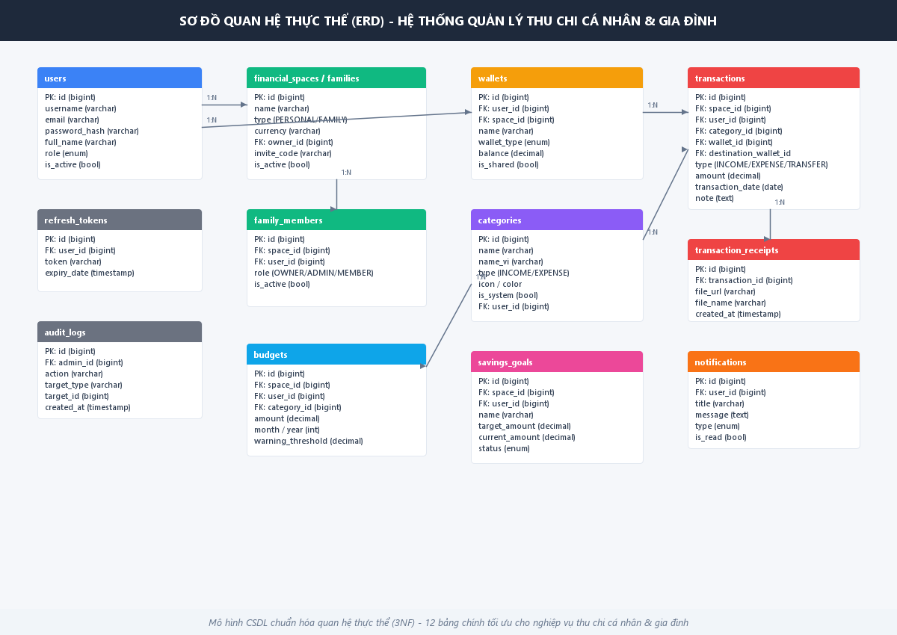
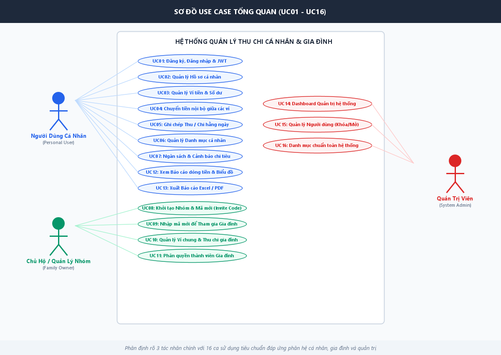
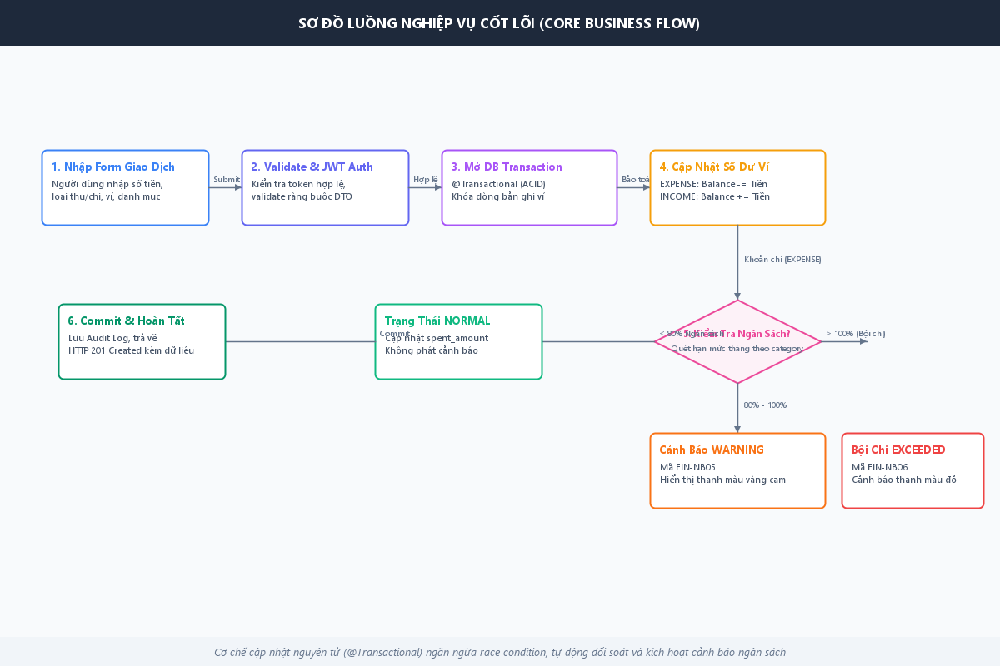
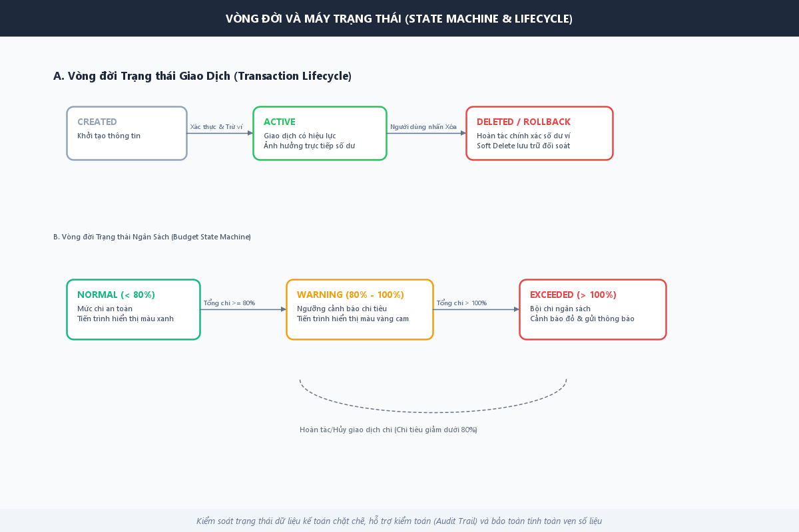
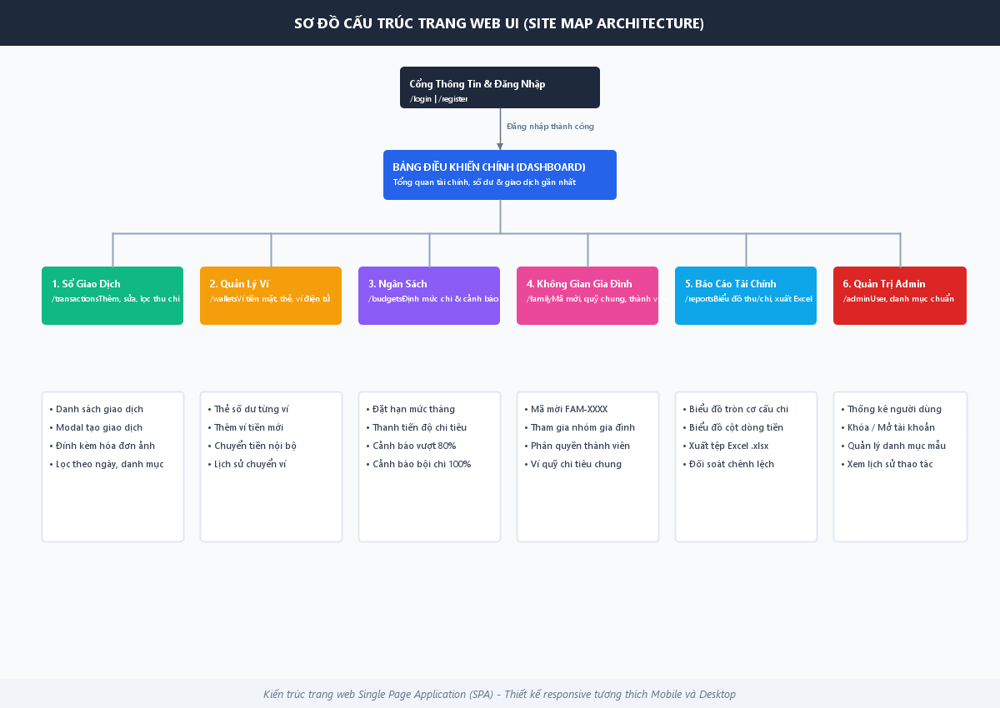

<!-- Tác giả: Nguyễn Mạnh Thắng (QA/Tester & Báo cáo) -->
# TÀI LIỆU ĐẶC TẢ YÊU CẦU PHẦN MỀM (SRS)
## HỆ THỐNG QUẢN LÝ THU CHI CÁ NHÂN VÀ GIA ĐÌNH
*(Personal & Family Financial Management System - Spring Boot & React / Web UI)*

---

### THÔNG TIN DỰ ÁN & PHÂN CÔNG KỸ THUẬT
- **Học phần:** Phát triển Dự án Phần mềm / Đồ án Chuyên ngành
- **Lớp học phần:** HN-KS24-CNTT1
- **Nhóm thực hiện:** Nhóm 04
- **Giảng viên hướng dẫn:** ThS. Giảng viên Bùi Thanh Hải
- **Mã tài liệu:** SRS-FINANCE-SB-2026-001
- **Phiên bản:** 1.0 (Trạng thái: Hoàn thiện phục vụ nghiệm thu đồ án)
- **Hạn nộp & Ngày nộp:** 13/11/2026

#### Danh sách thành viên & Trách nhiệm chính:
1. **Trần Hữu Nhật** - *Backend & DevOps Lead*: Kiến trúc hệ thống Spring Boot, JWT Security, Service cốt lõi, Docker & Nginx.
2. **Nguyễn Hoàng Phúc** - *Frontend Lead & UI/UX*: Giao diện Web SPA, trực quan hóa dòng tiền, tích hợp RESTful API.
3. **La Thế Phong** - *Database & Data Lead*: Lược đồ quan hệ CSDL (ERD), kịch bản init.sql, tối ưu hóa truy vấn đối soát số dư.
4. **Nguyễn Mạnh Thắng** - *QA / Tester & Viết báo cáo*: Thiết kế Test Cases (UC01 - UC16), kiểm thử toàn diện E2E, quản trị lỗi và biên soạn tài liệu đồ án.

---

## PHẦN 1: TỔNG QUAN HỆ THỐNG

### 1.1 Mục đích tài liệu
Tài liệu này đặc tả chi tiết toàn bộ yêu cầu chức năng và phi chức năng của **"Hệ thống Quản lý Thu chi Cá nhân và Gia đình"**. Tài liệu đóng vai trò là căn cứ kỹ thuật chính xác phục vụ thiết kế cơ sở dữ liệu, xây dựng RESTful API, triển khai giao diện người dùng, lập kế hoạch kiểm thử (Test Cases) và nghiệm thu dự án.

### 1.2 Bối cảnh & Lý do chọn đề tài
Quản lý tài chính cá nhân và phân bổ ngân sách gia đình là một nhu cầu thiết yếu đối với mỗi cá nhân và hộ gia đình trong xã hội hiện đại. Tuy nhiên, phần lớn mọi người vẫn duy trì thói quen ghi chép thủ công trên sổ tay hoặc ghi chú rải rác trên điện thoại, dẫn đến việc dễ thất lạc số liệu, khó nắm bắt bức tranh toàn cảnh về dòng tiền, và thường xuyên rơi vào tình trạng chi tiêu vượt quá hạn mức. Đặc biệt trong phạm vi gia đình, việc minh bạch các khoản chi tiêu chung, chia sẻ trách nhiệm tài chính và đóng góp vào các quỹ mục tiêu chung (mua sắm tài sản, du lịch, quỹ khẩn cấp) thường gặp nhiều bất cập.

Dự án cung cấp giải pháp chuyển đổi số toàn diện trong quản lý tài chính: hỗ trợ cá nhân ghi chép các giao dịch thu chi nhanh chóng, lập kế hoạch ngân sách và phân tích dòng tiền; đồng thời cung cấp tính năng "Không gian gia đình" cho phép các thành viên cùng quản lý các ví chung một cách minh bạch, nhận cảnh báo khi vượt ngân sách và hướng tới các mục tiêu tài chính bền vững.

---

## PHẦN 2: THIẾT KẾ KIẾN TRÚC & SƠ ĐỒ HỆ THỐNG

### 2.1 Sơ đồ Quan hệ Thực thể (ERD)
Hệ thống chuẩn hóa gồm 12 bảng thực thể chính: `users`, `refresh_tokens`, `financial_spaces` (gia đình), `family_members`, `wallets`, `categories`, `transactions`, `transaction_receipts`, `budgets`, `savings_goals`, `notifications`, `audit_logs`.

### 2.2 Sơ đồ Use Case Tổng quan (UC01 – UC16)
Bao gồm 3 tác nhân chính: **Người dùng cá nhân (Personal User)**, **Chủ hộ gia đình (Family Owner)**, và **Quản trị viên (System Admin)**.

### 2.3 Sơ đồ Luồng Nghiệp vụ Cốt lõi (Core Business Flow)
Quy trình ghi nhận giao dịch thu chi, đảm bảo tính nguyên tử ACID (@Transactional), cập nhật biến động số dư tức thì và tự động kiểm tra cảnh báo hạn mức ngân sách tháng.

### 2.4 Vòng đời và Máy trạng thái (State Machine & Lifecycle)
- **Giao dịch:** `CREATED` -> `ACTIVE` -> `DELETED` (Soft Delete hoàn trả chính xác số dư ví).
- **Ngân sách:** `NORMAL` (< 80%) -> `WARNING` (80% - 100%) -> `EXCEEDED` (> 100% Bội chi).

### 2.5 Sơ đồ Cấu trúc Trang Web UI (Site Map)
Cấu trúc điều hướng giao diện Single Page Application đáp ứng đầy đủ phân hệ người dùng cá nhân, gia đình và quản trị hệ thống.

---

## PHẦN 3: ĐẶC TẢ CHI TIẾT 16 USE CASE (UC01 – UC16)

| Mã UC | Tên Ca Sử Dụng | Phân Hệ | Tác Nhân Chính | Trạng Thái |
|---|---|---|---|---|
| **UC01** | Đăng ký, Đăng nhập, JWT & Refresh Token | Tài khoản | Mọi đối tượng | Đã hoàn thành |
| **UC02** | Xem & Cập nhật Hồ sơ cá nhân | Tài khoản | Người dùng | Đã hoàn thành |
| **UC03** | Khởi tạo & Quản lý danh sách Ví tiền cá nhân | Nguồn tiền | Người dùng cá nhân | Đã hoàn thành |
| **UC04** | Chuyển tiền qua lại giữa các ví nội bộ | Nguồn tiền | Người dùng cá nhân | Đã hoàn thành |
| **UC05** | Thêm, sửa, xóa Giao dịch Thu/Chi (Transaction) | Sổ giao dịch | Người dùng, Thành viên | Đã hoàn thành |
| **UC06** | Quản lý Danh mục Thu Chi cá nhân (Category) | Phân loại | Người dùng | Đã hoàn thành |
| **UC07** | Thiết lập Hạn mức Ngân sách & Cảnh báo vượt chi | Ngân sách | Người dùng, Chủ hộ | Đã hoàn thành |
| **UC08** | Khởi tạo Nhóm Gia đình & Sinh mã mời (Invite Code) | Gia đình | Chủ hộ (Family Owner) | Đã hoàn thành |
| **UC09** | Nhập mã mời để Tham gia Gia đình | Gia đình | Người dùng | Đã hoàn thành |
| **UC10** | Quản lý Ví chung & Ghi chép chi tiêu Gia đình | Gia đình | Thành viên gia đình | Đã hoàn thành |
| **UC11** | Phân quyền & Quản lý thành viên trong Gia đình | Gia đình | Chủ hộ (Family Owner) | Đã hoàn thành |
| **UC12** | Xem Báo cáo Dòng tiền & Biểu đồ Cơ cấu chi tiêu | Báo cáo | Người dùng, Thành viên | Đã hoàn thành |
| **UC13** | Xuất Báo cáo Thu Chi sang tệp Excel (.xlsx) | Báo cáo | Người dùng, Chủ hộ | Đã hoàn thành |
| **UC14** | Bảng điều khiển Quản trị hệ thống (Admin Dashboard) | Quản trị | Quản trị viên (Admin) | Đã hoàn thành |
| **UC15** | Quản lý Người dùng hệ thống (Khóa / Mở khóa) | Quản trị | Quản trị viên (Admin) | Đã hoàn thành |
| **UC16** | Quản lý Danh mục thu chi mặc định toàn hệ thống | Quản trị | Quản trị viên (Admin) | Đã hoàn thành |

---

## PHẦN 4: HỆ THỐNG THÔNG BÁO & MÃ CẢNH BÁO

- **FIN-NB01:** Đăng ký tài khoản thành công.
- **FIN-NB02:** Đã ghi nhận giao dịch vào ví tiền.
- **FIN-NB03:** Chuyển tiền nội bộ giữa các ví thành công.
- **FIN-NB04:** Tạo nhóm gia đình thành công kèm mã mời duy nhất.
- **FIN-NB05:** Cảnh báo: Danh mục chi tiêu đã chạm ngưỡng 80% ngân sách tháng.
- **FIN-NB06:** Bội chi: Bạn đã chi tiêu vượt quá 100% hạn mức ngân sách đã đề ra.
- **FIN-NB07:** Cảnh báo: Số dư khả dụng trong ví không đủ để chi tiêu.
- **FIN-NB08:** Lỗi: Mã mời tham gia gia đình không hợp lệ hoặc đã hết hạn.
- **FIN-NB09:** Lỗi: Không thể xóa ví tiền đã phát sinh dữ liệu kế toán.
- **FIN-NB10:** Lỗi: Email đã được sử dụng bởi một tài khoản khác.
- **FIN-NB11:** Lỗi: Phiên đăng nhập đã hết hạn. Vui lòng đăng nhập lại.
- **FIN-NB12:** Xác nhận: Xác nhận trước khi rời khỏi nhóm gia đình.

---

## PHẦN 5: CẤU HÌNH VẬN HÀNH & DEVOPS
- **Backend:** Java 17, Spring Boot 3.3.5, Spring Security 6 (JWT Stateless), Spring Data JPA, Apache POI 5.2.5.
- **Database:** MySQL 8.0 chuẩn InnoDB utf8mb4. File kịch bản khởi tạo: `database/init.sql`.
- **Reverse Proxy:** Nginx cấu hình tại `nginx/default.conf`.
- **Containerization:** Docker multi-stage build kết hợp `docker-compose.yml`.
